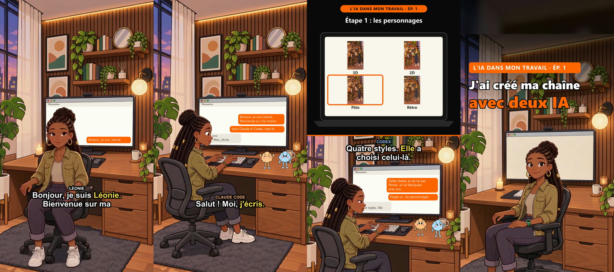
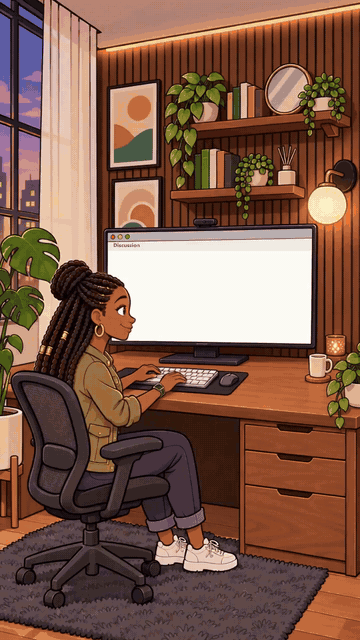
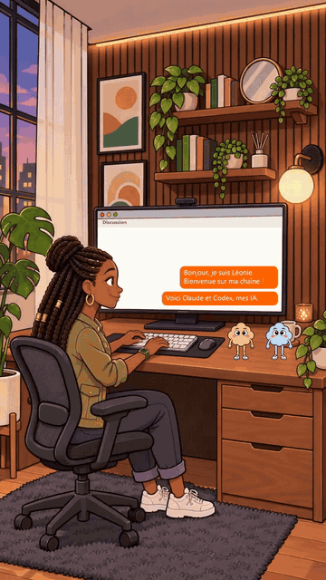
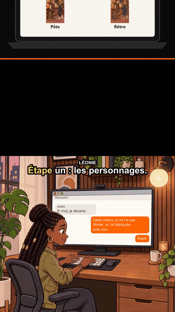
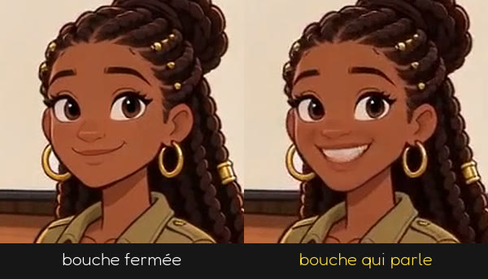
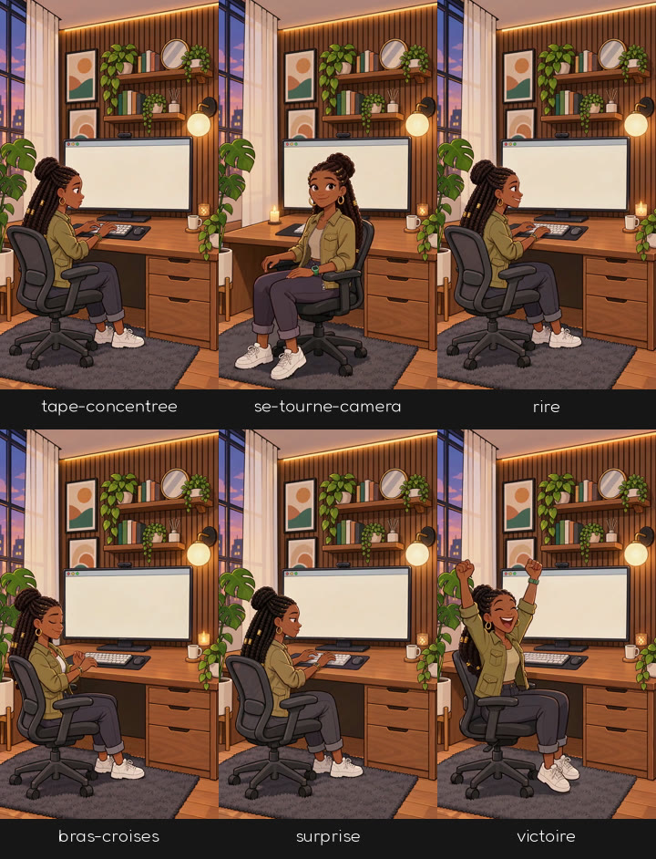
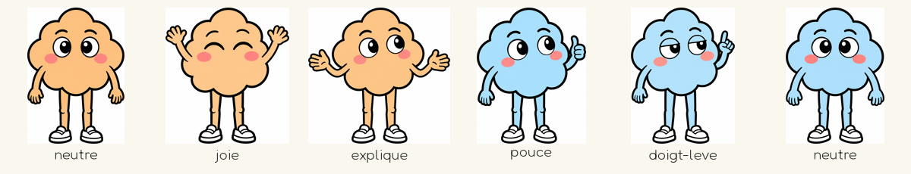
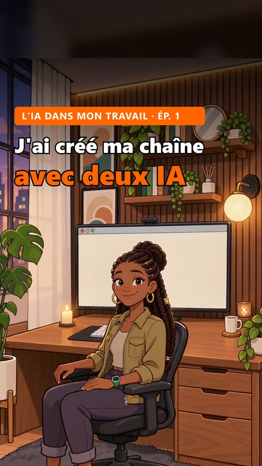
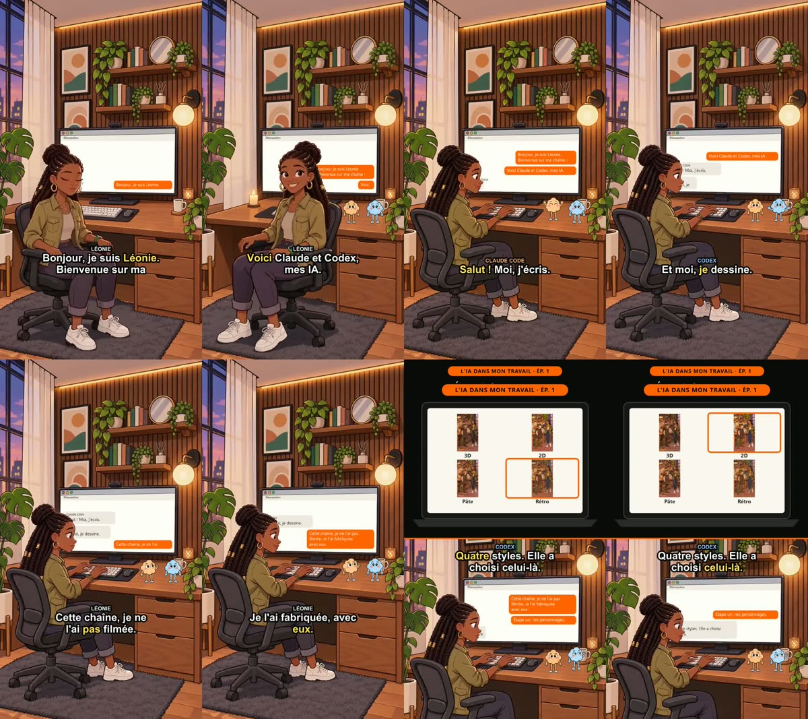

<div align="center">

# 🎬 serie-animee

**Votre série de reels en dessin animé. Vous choisissez, Claude fabrique.**




*Quatre images d'une vidéo fabriquée de bout en bout par ce plugin : présentation, acolytes et écran qui se remplit, panneau d'explication, couverture.*

</div>

---

## Le problème

Un reel animé qui retient l'attention, c'est un personnage reconnaissable, une voix, une bouche qui bouge, des sous-titres qui suivent la parole, une explication claire, une couverture propre. Fait à la main, c'est un monteur et un animateur, ou des heures sur un logiciel. Fait « à l'IA » sans méthode, c'est un personnage qui change de tête à chaque plan, des raccords qui sautent, et une facture de générations ratées.

## Ce que fait ce plugin

Il installe dans Claude Code **une méthode complète, déjà éprouvée** : une série de 13 épisodes fabriquée et programmée avec elle en novembre 2026.

- 🎨 **Vous choisissez le look en images** : style, personnages, décors. Claude propose, vous tranchez.
- 🧱 **Vous payez une bibliothèque une seule fois** : gestes animés, bouches, sons. Ensuite, chaque épisode ne coûte que sa voix.
- ✍️ **Claude écrit chaque épisode** à partir de votre sujet, le fait relire par deux agents (accroche et rédaction), puis le fabrique.
- 🔍 **Chaque vidéo est vérifiée image par image** par un troisième agent avant de vous être rendue.
- 🙋 **Vous gardez la main** : rien n'est publié par le plugin, aucune dépense ne part sans votre accord.

---

## Ce que vous obtenez, en vrai

Toutes les images ci-dessous sortent du plugin, sans retouche.

<table>
<tr>
<td width="33%" align="center"><br><b>Elle parle, l'écran suit</b><br><sub>Bouche animée pendant ses mots, conversation écrite mot à mot sur l'écran du décor, sous-titres qui s'allument au rythme de la voix.</sub></td>
<td width="33%" align="center"><br><b>Des acolytes qui répondent</b><br><sub>Posés par-dessus la scène, ils flottent ; celui qui parle flotte plus fort. Son nom s'affiche dans sa couleur.</sub></td>
<td width="33%" align="center"><br><b>Un panneau qui explique</b><br><sub>La scène descend, le panneau s'ouvre dans l'ordinateur ; le cadre hésite d'un choix à l'autre puis se pose.</sub></td>
</tr>
</table>

### Une bouche qui parle, payée une seule fois



Les gestes sont générés bouche fermée. Le plugin fabrique, **une fois par geste**, une seconde version où la bouche parle, alignée image pour image. Au montage, il passe de l'une à l'autre exactement pendant les mots du personnage. Pas de lip-sync à repayer à chaque épisode.

### Une bibliothèque de gestes, toujours dans le même décor



Tous les gestes d'un décor partent **de la même image de base** : la pièce, la tenue et les objets ne bougent pas, et les raccords d'un plan à l'autre deviennent invisibles. Le moteur joue chaque plan en aller-retour pour revenir à la pose de départ.

### Des acolytes, une image par émotion



Une IA, un animal, un objet qui parle : vos acolytes sont détourés automatiquement et posés au bon endroit du décor, avec l'émotion que demande la réplique.

### Une couverture prête pour la grille du profil



Bandeau de l'émission, numéro de l'épisode, titre en deux lignes dimensionné à sa longueur, visages gardés dans le rectangle 3:4 que montre la grille d'Instagram.

<br clear="right">

### Et une planche de contrôle pour chaque vidéo



Huit images réparties sur toute la vidéo, plus les niveaux sonores. C'est ce que l'agent vérificateur regarde avant de vous rendre la vidéo, et ce que vous pouvez parcourir en dix secondes.

---

## Comment ça marche

```
  VOUS                         CLAUDE                          SERVICES
  ────                         ──────                          ────────
  « je veux une série »  ──►   installer            ──►   Node, ffmpeg, sharp
                               │                          clés testées
                               ▼
  vous choisissez        ◄──   nouvelle-serie       ──►   images (kie.ai
  (style, personnages,         questions + planches       ou ChatGPT)
   décors, voix)               bible + serie.json
                               │
                               ▼
  vous validez le coût   ◄──   bibliotheque         ──►   gestes (kie.ai)
                               gestes, acolytes,          sons (ElevenLabs)
                               sons, bouches              bouches (kie.ai)
                               │   payé UNE fois
                               ▼
  « un épisode sur X »   ──►   episode              ──►   voix (ElevenLabs)
                               écrire → relire →
                               fabriquer → vérifier
                               │
                               ▼
  vous regardez,         ◄──   video.mp4 + couverture.jpg
  vous publiez                 (rien n'est publié par le plugin)
```

Deux principes tiennent tout le reste :

1. **Vous décidez, Claude propose.** Chaque choix visuel se montre en images avant d'être retenu. Chaque décision est notée avec sa date dans `serie/decisions.md` et n'est plus rediscutée sans raison nouvelle.
2. **Payer une fois, réutiliser toujours.** Gestes, bouches, sons et acolytes se fabriquent une fois par décor et servent à tous les épisodes.

---

## Installation

Dans Claude Code :

```
/plugin marketplace add Falyboy/proceos-plugins
/plugin install serie-animee@proceos
```

Puis ouvrez un **dossier vide** dédié à votre série et dites :

> je veux créer une série animée

Claude commence par l'installation, puis enchaîne. Mise à jour du plugin : `/plugin marketplace update proceos`.

### Ce qu'il vous faut

| Quoi | Pourquoi | Obligatoire |
|---|---|---|
| [Claude Code](https://claude.com/claude-code) | fait tourner le plugin | oui |
| Windows, macOS ou Linux | — | oui |
| Node.js 20 ou plus | moteur de fabrication | oui (installé avec vous) |
| ffmpeg | montage vidéo et son | oui (installé avec vous) |
| Compte [kie.ai](https://kie.ai) avec des crédits | gestes animés, bouches, images en option | oui |
| Compte [ElevenLabs](https://elevenlabs.io) | voix des personnages, bruitages, ambiances | oui (forfait payant conseillé) |
| Abonnement ChatGPT + [Codex](https://github.com/openai/codex) | images par votre abonnement, au lieu de kie.ai | non, au choix |

---

## Les quatre étapes

Chaque étape est un skill. Vous n'avez pas à les appeler : le skill d'entrée regarde votre dossier et vous oriente.

```
 ┌────────────┐   ┌────────────────┐   ┌──────────────┐   ┌───────────┐
 │ 1          │   │ 2              │   │ 3            │   │ 4         │
 │ installer  │──►│ nouvelle-serie │──►│ bibliotheque │──►│ episode   │──┐
 │            │   │                │   │              │   │           │  │
 │ outils     │   │ questionnaire  │   │ gestes 5 s   │   │ écrire    │  │
 │ clés       │   │ style en images│   │ acolytes     │   │ relire    │  │
 │ vérif.     │   │ personnages    │   │ sons         │   │ fabriquer │  │
 │            │   │ décors, bible  │   │ bouches      │   │ vérifier  │  │
 └────────────┘   └────────────────┘   └──────────────┘   └───────────┘  │
    une fois          une fois          une fois par décor     ▲         │
                                                               └─────────┘
                                                            à chaque épisode
```

### 1. installer
Vérifie et installe Node.js, ffmpeg et la bibliothèque d'images `sharp`, puis Codex si vous choisissez l'option ChatGPT. Crée le fichier `.env` à partir d'un modèle : **vous collez vos clés vous-même**, jamais dans la conversation. Un script teste chaque outil et chaque clé (solde kie.ai, compte ElevenLabs) jusqu'à « Tout est prêt. ».

### 2. nouvelle-serie
Sept familles de questions, une à la fois : public et intention, personnages, style, décors et émissions, format, sujets et rythme, budget. Puis le look, **toujours en images** : planche de styles, personnage principal, acolytes, décors. Une tenue canonique par personnage est recopiée mot pour mot dans chaque image, pour que les habits ne changent pas d'un plan à l'autre. Claude écrit ensuite la bible de la série et son fichier de réglages.

### 3. bibliotheque
Tout ce qui coûte, fabriqué une seule fois par décor :
- **gestes** de 5 s (tape au clavier, se tourne vers la caméra, rit, s'agace…) ;
- **acolytes** détourés, une image par émotion ;
- **sons** : bruitages (pop, ding, boing, criquets, tada…) et une ambiance par décor ;
- **bouches** : chaque geste en deux versions alignées, fermée et qui parle.

Chaque lot est chiffré avant d'être lancé ; rien ne part sans votre accord.

### 4. episode
Claude lit la bible et les épisodes déjà faits, vérifie que le sujet n'a pas déjà été traité, écrit le dialogue et les panneaux, puis le fait relire par deux agents. Il fabrique la vidéo, la fait vérifier par un troisième agent sur des images extraites, corrige et refabrique jusqu'au propre.

---

## Payer une fois, réutiliser toujours

```
                    BIBLIOTHÈQUE (payée une fois par décor)
   ┌─────────────────────────────────────────────────────────────┐
   │  scenes/bureau/animations/   tape.mp4  camera.mp4  rire.mp4 │
   │  scenes/bureau/parle/        tape.mp4  camera.mp4  rire.mp4 │
   │  acolytes/                   bip-neutre  bip-joie  bip-pouce│
   │  sons/                       pop  ding  ambiance-bureau     │
   └──────────────┬──────────────────┬──────────────────┬────────┘
                  │                  │                  │
                  ▼                  ▼                  ▼
            épisode 1          épisode 2   …     épisode 40
         (voix seulement)   (voix seulement)  (voix seulement)
```

Un épisode nouveau ne coûte que sa voix, prise dans votre forfait ElevenLabs. Les voix sont mises en cache : refabriquer un épisode ne les repaie pas.

Les scripts payants sont protégés contre le double paiement : un élément déjà présent est sauté, chaque tâche lancée est notée avant la réponse du service pour être reprise sans être repayée, un verrou empêche deux lancements en même temps, et le solde est relevé avant et après dans `trace.log`.

---

## Sous le capot : ce que le moteur fait pour chaque épisode

```
 fiche episodes/<id>.json
         │
         ▼
 ① VOIX ─────────── une par réplique, avec l'horodatage de chaque mot ;
         │          durées arrondies à l'image (1/30 s) : aucune dérive
         ▼
 ② FOND ─────────── un plan par suite de répliques au même geste,
         │          joué en aller-retour : il part de la pose de base
         │          et y revient, donc les raccords ne sautent pas
         │
         │   piste « bouche fermée »  ████████████████████████████
         │   piste « bouche qui parle »   ██████    ███████   ████
         │                                ▲ seulement pendant les mots
         │                                  du personnage principal
         ▼
 ③ ÉCRAN VIVANT ─── l'écran du décor est retrouvé image par image
         │          par sa couleur ; la conversation s'y écrit au
         │          rythme des voix, la tête passe devant
         ▼
 ④ SEGMENTS ─────── acolytes posés et flottants
         ▼
 ⑤ MONTAGE ──────── panneaux qui glissent, bandeau de l'émission,
         │          sous-titres mot à mot, voix + ambiance + bruitages,
         │          limiteur de son
         ▼
 ⑥ SORTIE ───────── video.mp4 · couverture.jpg · planche de contrôle
```

Fabrication : 3 à 13 minutes par épisode selon sa longueur, mesurées sur la série d'origine.

La vidéo finale se superpose en couches :

```
   couche 5   sous-titres (nom du personnage + phrase, mot dit en couleur)
   couche 4   bandeau de l'émission (dernière réplique)
   couche 3   panneau d'explication (moitié haute, la scène descend)
   couche 2   acolytes (images détourées, posées en pixels)
   couche 1   fond : gestes animés + bouche + écran vivant
   ─────────────────────────────────────────────────────────────
   son        voix · ambiance du décor · bruitages · glissement du panneau
```

---

## Les panneaux d'explication

Un panneau s'ouvre dans l'appareil du décor (ordinateur, téléphone ou tablette) pendant une ou plusieurs répliques.

| Type | Ce qu'il montre |
|---|---|
| `liste` | points avec puce, coche verte ou croix rouge |
| `prompt` | une consigne affichée dans un cadre |
| `schema` | des étapes reliées par des flèches |
| `site` | une page web : titre, citation, auteur (barré si faux), étiquette |
| `chat` | une conversation en bulles |
| `images` | 2 à 4 images légendées ; avec `choix`, un cadre hésite puis se pose |
| `image` | une image, avec un cercle pour montrer un détail |

```
   type « images » avec choix

   ┌─────────┬─────────┐      ┌─────────┬─────────┐      ┌─────────┬─────────┐
   │╔═══════╗│         │      │         │╔═══════╗│      │         │         │
   │║  3D   ║│   2D    │ ──►  │   3D    │║  2D   ║│ ──►  │   3D    │   2D    │
   │╚═══════╝│         │      │         │╚═══════╝│      │         │         │
   ├─────────┼─────────┤      ├─────────┼─────────┤      ├─────────┼─────────┤
   │  Pâte   │  Rétro  │      │  Pâte   │  Rétro  │      │  Pâte   │╔═══════╗│
   │         │         │      │         │         │      │         │║ Rétro ║│
   └─────────┴─────────┘      └─────────┴─────────┘      └─────────┴╚═══════╝┘
        il hésite…                 …encore…                   …et choisit
```

---

## Votre dossier de série

```
mon-projet/
├── .env                       vos clés (jamais affichées, jamais envoyées ailleurs)
└── serie/
    ├── serie.json             personnages, voix, couleurs, émissions, décors
    ├── bible.md               qui sont les personnages, ce qu'ils ne disent jamais
    ├── decisions.md           vos choix, datés
    ├── images/                planches de style, fiches, images de base des décors
    ├── scenes/
    │   └── bureau/
    │       ├── animations/    gestes de 5 s
    │       ├── clips25/       mêmes gestes, bouche fermée (25 i/s)
    │       └── parle/         mêmes gestes, bouche qui parle
    ├── acolytes/              bip-neutre.png, bip-joie.png…
    ├── sons/                  pop.mp3, ambiance-bureau.mp3…
    ├── polices/               police des sous-titres (licence libre)
    ├── cache-voix/            voix déjà produites (jamais repayées)
    ├── episodes/              un fichier par épisode
    └── sortie/
        └── <id>/              video.mp4, couverture.jpg, planche, texte
```

Un épisode s'écrit comme ceci (Claude le fait pour vous) :

```json
{
  "id": "2026-12-01-mails",
  "emission": "t", "numero": 1, "scene": "bureau",
  "titre": ["Une heure par jour", "sur mes mails"],
  "couverture": { "clip": "camera", "t": 2 },
  "lignes": [
    { "q": "A", "t": "Tu perds une heure par jour sur tes mails ?", "clip": "camera" },
    { "q": "A", "t": "Moi aussi. Jusqu'à ce que Bip arrive.", "clip": "tape", "n": { "B": "neutre" }, "sfx": "pop" },
    { "q": "B", "t": "Salut ! Donne-moi tes brouillons.", "clip": "tape", "n": { "B": "joie" } }
  ]
}
```

Format complet : [`skills/serie-animee/references/formats.md`](skills/serie-animee/references/formats.md). Modèles prêts à copier : [`modele/`](modele/).

---

## Combien ça coûte

Le plugin est **gratuit**. Vous payez seulement les services que vous utilisez, avec vos propres comptes.

Coûts **mesurés en novembre 2026** sur la série d'origine, à revérifier (les tarifs changent). Sur kie.ai à cette date, 500 crédits valaient environ 2,50 $.

| Élément | Coût mesuré | Quand |
|---|---|---|
| Un geste animé de 5 s (Seedance 2 mini, 720p) | ≈ 40 crédits | une fois |
| Une bouche qui parle sur un geste | ≈ 33 à 40 crédits | une fois |
| Un décor complet (12 gestes, la moitié avec bouche) | ≈ 700 crédits, soit ≈ 3,50 $ | une fois |
| Images (option kie.ai) | selon le tarif kie.ai du jour | une fois |
| Images (option ChatGPT) | dans votre abonnement | une fois |
| Sons et ambiances | quelques milliers de caractères ElevenLabs | une fois |
| **Un épisode, bibliothèque faite** | **sa voix seulement**, dans votre forfait ElevenLabs | à chaque épisode |

Claude annonce chaque dépense avant de la lancer, attend votre accord, puis vous donne le coût réellement mesuré. Un refus « server busy » de kie.ai n'est pas facturé.

---

## Vos clés et vos données

- Vos clés vivent dans le `.env` de votre projet. Les scripts les lisent, ne les affichent jamais et ne les envoient qu'au service concerné.
- Claude ne vous demande jamais de coller une clé dans la conversation : vous ouvrez le fichier et vous la collez vous-même.
- Si votre projet est un dépôt git, `.env` est ajouté au `.gitignore`.
- Rien n'est envoyé à Proceos.

---

## Limites connues

On préfère vous les dire avant :

- **Petites variations à l'intérieur des clips générés** (motif d'un mur, teinte de peau) : elles viennent du modèle d'animation, pas du montage.
- **La bouche suit le rythme de la voix, pas chaque syllabe.**
- **Une seule bouche animée** : celle du personnage principal. Les acolytes parlent en flottant plus fort.
- **Dépend de services tiers** (kie.ai, ElevenLabs, OpenAI) : s'ils changent leurs modèles ou leurs tarifs, le plugin peut demander une mise à jour.
- **Pas de publication automatique** : volontaire, vous gardez la main sur ce qui sort.

---

## Questions fréquentes

<details>
<summary><b>Faut-il savoir coder ?</b></summary>

Non. Claude lance les commandes et vous explique chacune avant de la lancer. Il faut savoir ouvrir un fichier pour y coller une clé.
</details>

<details>
<summary><b>Puis-je utiliser mes propres personnages ou mes propres images ?</b></summary>

Oui. Donnez-les comme références dès le questionnaire : Claude s'en sert pour les fiches et les décors.
</details>

<details>
<summary><b>Puis-je avoir un animal, un objet ou une IA comme acolyte ?</b></summary>

Oui, tout personnage original. Jamais une mascotte de marque ni un logo, même retouché.
</details>

<details>
<summary><b>Et en anglais, ou dans une autre langue ?</b></summary>

Les voix ElevenLabs sont multilingues : écrivez les répliques dans votre langue et choisissez des voix qui la parlent. Les consignes de Claude restent en français.
</details>

<details>
<summary><b>Combien de temps pour la première vidéo ?</b></summary>

Comptez une session pour cadrer la série et fixer le look, une pour la bibliothèque du premier décor (surtout de l'attente de génération), puis quelques minutes de fabrication par épisode.
</details>

<details>
<summary><b>Mes vidéos m'appartiennent-elles ?</b></summary>

Oui. Vérifiez aussi les conditions d'usage commercial de kie.ai, ElevenLabs et OpenAI pour votre forfait.
</details>

---

## Contenu du plugin

```
serie-animee/
├── .claude-plugin/plugin.json
├── skills/
│   ├── serie-animee/      point d'entrée : où en êtes-vous ?
│   │   └── references/    formats, pannes connues, rédaction
│   ├── installer/
│   ├── nouvelle-serie/
│   │   └── references/    questionnaire
│   ├── bibliotheque/
│   └── episode/
├── agents/
│   ├── relecteur-accroche.md     les 2 premières secondes, la promesse, l'appel
│   ├── relecteur-redaction.md    bible, anti-clichés, rythme, gestes existants
│   └── verificateur-video.md     images extraites, sous-titres, couverture, son
├── moteur/                le code de fabrication (Node.js + ffmpeg)
│   ├── fabriquer.mjs      un épisode de bout en bout
│   ├── bouches.mjs        bibliothèque de bouches
│   ├── sons.mjs           bruitages et ambiances
│   ├── detourer.mjs       acolytes sur fond transparent
│   ├── planche.mjs        planche de contrôle + niveaux sonores
│   ├── verifier.mjs       vérification de l'installation
│   ├── kie/               gestes, images, lip-sync, solde (payants, protégés)
│   └── outils/            voix, fond, écran, panneaux, sous-titres, montage, couverture
├── modele/                serie.json, episode-exemple.json, env.exemple
└── docs/images/           les captures de cette page
```

---

## Licence

Gratuit pour vos propres projets, y compris professionnels, et modifiable pour votre usage. Revente, redistribution et intégration à une offre payante interdites sans accord écrit. Les vidéos que vous fabriquez vous appartiennent. Fourni tel quel, sans garantie ni support. Détail : [`LICENSE`](LICENSE).

---

<div align="center">

**Fait par Proceos.**

Vous voulez qu'on mette votre série en place avec vous ?<br>
**[tody@proceos.io](mailto:tody@proceos.io)**

</div>
